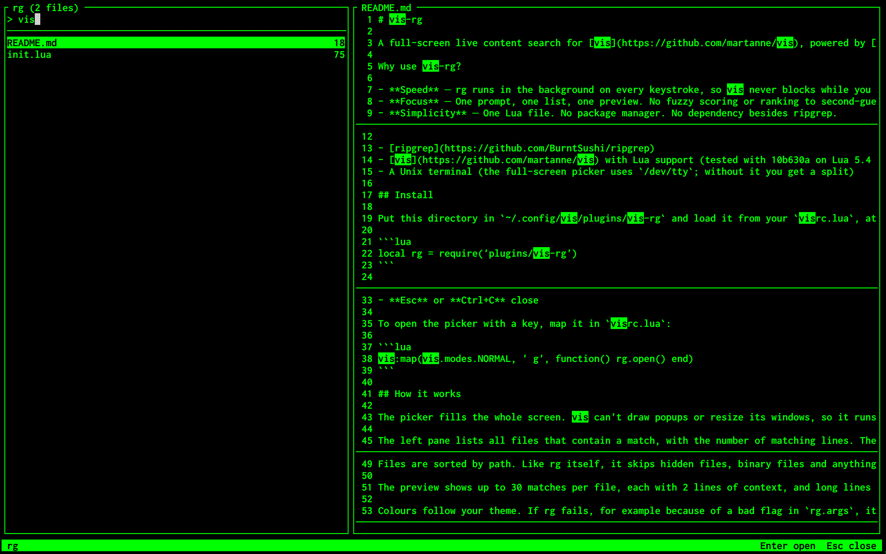

# vis-rg

A full-screen live content search for [vis](https://github.com/martanne/vis), powered by [ripgrep](https://github.com/BurntSushi/ripgrep). The vis port of [rg.vim](https://github.com/Solver42/rg.vim).



Why use vis-rg?

- **Speed** — rg runs in the background on every keystroke, so vis never blocks while you type.
- **Focus** — One prompt, one list, one preview. No fuzzy scoring or ranking to second-guess: the query is a literal string and the results are sorted by path.
- **Simplicity** — One Lua file. No package manager. No dependency besides ripgrep.

## Requirements

- [ripgrep](https://github.com/BurntSushi/ripgrep)
- [vis](https://github.com/martanne/vis) built with Lua 5.4+ support
- A Unix terminal (the full-screen picker uses `/dev/tty`; without it you get a split)

## Install

Put this directory in `~/.config/vis/plugins/vis-rg` and load it from your `visrc.lua`, at the top level so it runs when vis starts:

```lua
local rg = require('plugins/vis-rg')
```

## Usage

- **:Rg** opens the picker in the current directory
- **:Rg {text}** opens it with an initial query
- **Type** to search, **Backspace** or **Ctrl+H** to delete
- **Ctrl+N**, **Ctrl+J** or **Down** select next file **Ctrl+P**, **Ctrl+K** or **Up** select previous file
- **Ctrl+D** or **Ctrl+F** scroll preview down **Ctrl+B** or **Ctrl+U** scroll preview up
- **Enter** or **Ctrl+Y** open the file at its first match
- **Esc** or **Ctrl+C** close

To open the picker with a key, map it in `visrc.lua`:

```lua
vis:map(vis.modes.NORMAL, ' g', ':Rg<Enter>')
```

## How it works

The left pane lists all files that contain a match, with the number of matching lines. The right pane shows the matches in the highlighted file.

The query is a literal string, not a regular expression. It is smart-case: case-insensitive unless the query contains an uppercase letter. With an empty query every file is listed and the preview shows the top of the highlighted file.

Files are sorted by path. Like rg itself, it skips hidden files, binary files and anything ignored by `.gitignore`, `.ignore` and `.rgignore`, and your ripgrep config file is honoured. Only the first 500 files are listed, and the title shows the total.

The preview shows up to 30 matches per file, each with 2 lines of context, and long lines are cut at the edge of the pane. Binary files, files that can't be read and files over 2 MB are not read, and the preview says so instead. Paths are resolved against vis's working directory.

## Configuration

Set these after the `require`. Pass extra flags to rg, for example to include hidden files but not images:

```lua
rg.args = { '--hidden', '--glob', '!*.png' }
```

You can change how many files are listed:

```lua
rg.max_files = 1000
```

You can change how many matches are previewed per file, and how many lines of context surround each one:

```lua
rg.max_matches = 10
rg.context = 4
```

You can change how many lines the preview shows when the query is empty:

```lua
rg.preview_lines = 100
```

You can change the size in bytes above which files are not previewed:

```lua
rg.max_size = 1048576
```

You can override a colour (`selected`, `match`, `count`, `info`, `lineno`, `sep`, `prompt`) with a vis style string:

```lua
rg.styles.match = 'fore:black,back:green'
```

You can use a split of the running vis instead of the full screen, which takes half of it:

```lua
rg.fullscreen = false
```
